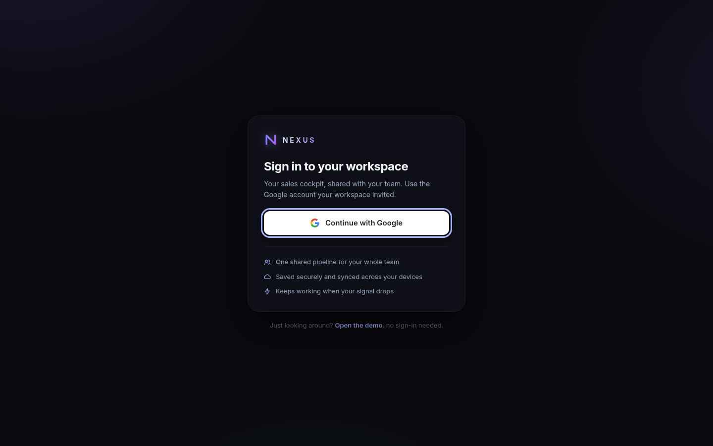
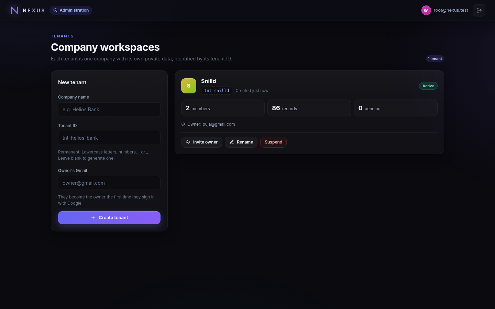
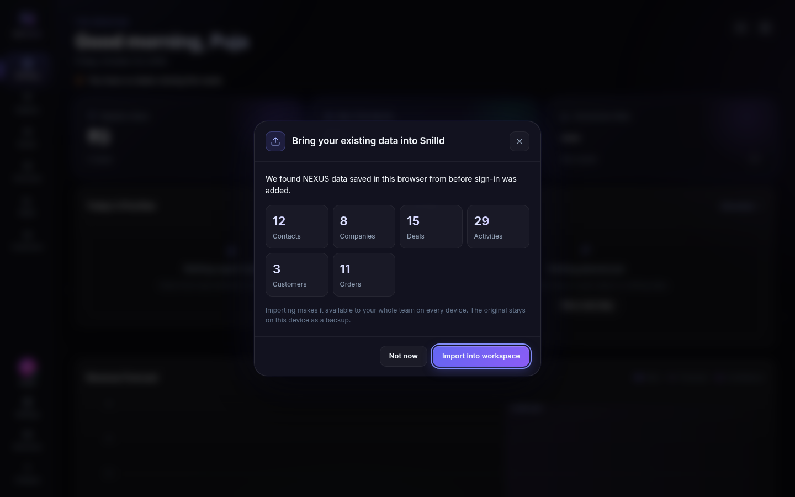

# NEXUS — Sales Intelligence Command Center

> *"Not a CRM. A cockpit."*

NEXUS is an ultra-fast, zero-runtime-dependency sales command center built with pure web standards (Vanilla HTML, CSS, and modern JavaScript). It departs from generic spreadsheets and dull grey enterprise tables to deliver a dark, glassmorphic cockpit inspired by Bloomberg terminals, mission control rooms, and tactical HUDs.

---

## 🌟 Table of Contents
- [Executive Overview](#executive-overview)
- [📖 Enterprise User Operations Guide](docs/USER_GUIDE.md) *(Step-by-step setup, workflows, and visual screenshots)*
- [Key Business Scenarios](#key-business-scenarios)
- [Feature Walkthrough](#feature-walkthrough)
- [Technical Architecture](#technical-architecture)
- [Data Storage & Isolation](#data-storage--isolation)
- [Multi-Tenant Workspaces & Google Sign-In](#multi-tenant-workspaces--google-sign-in)
- [Deployment & Environments](#deployment--environments)
- [Migrating the Original scrm Data](#migrating-the-original-scrm-data)
- [Local Development & Testing](#local-development--testing)
- [Secret & Config Management (Infisical)](#secret--config-management-infisical)

---

## 🎯 Executive Overview

Traditional CRMs often hinder sales momentum: sluggish page reloads, heavy client-side bundles, complex database roundtrips, and clunky interfaces. 

NEXUS is designed for speed and clarity:
- **Zero Runtime Dependencies:** Pure modern ES modules, native Canvas 2D charts, and CSS variables. Loads instantly with a negligible footprint.
- **Tactical Daily Focus:** Opens directly to **The Briefing**, a morning mission control highlighting high-probability deals, immediate follow-ups, and pipeline velocity.
- **Works Offline, Syncs Online:** Every screen reads from a validated local copy, so it stays instant and keeps working without signal. In the business app, changes queue up and sync to the server when you reconnect. Full JSON export and import are always available.
- **One App, Many Companies:** The business app at `scrm.snilld.in` is multi-tenant. Each company is a private workspace (a *tenant*, identified by its `tenant_id`), people sign in with their Google account, and workspaces are invite-only. The public demo at `crm.snilld.in` stays a sign-in-free sandbox with sample data.

---

## 💼 Key Business Scenarios

### 1. B2B Deal Pipeline & Opportunity Management
Track complex multi-stage enterprise sales opportunities from initial contact through formal closing:
- Visual stages: `Prospect` ➔ `Qualified` ➔ `Proposal` ➔ `Negotiation` ➔ `Closing` ➔ `Won` / `Lost`.
- Drag/step deals forward with automated conversion calculations.
- Backward-move safeguards and structured lost-reason capture to identify sales friction.

### 2. High-Touch Account Management & Customer HQ
Maintain relationships after deals close:
- Dedicated **Customer HQ** for tracking customer accounts, lifetime value (LTV), active contracts, and order history.
- Relationship health scores (0–100) calculated dynamically based on interaction frequency, deal values, and recency.

### 3. Action-Driven Sales Execution (The Chronicle)
Log every customer interaction in seconds without leaving the keyboard:
- Calls, meetings, emails, WhatsApp messages, status changes, and tactical notes.
- Quick-log shortcut actions with timestamped chronological timeline views.
- Deep bi-directional linking between contacts, companies, deals, and activity logs.
- **Next steps:** plan the next move ("Present GTM deck", "Follow up") against a date. The Chronicle opens on **Today**; scroll up for what's coming, scroll down for the past.

### 4. Multi-Stakeholder Selling
Enterprise deals involve several people, so NEXUS models them explicitly:
- **Companies** are first-class records with their own panel, people, deals, and history.
- Every deal carries a list of **stakeholders** with roles (Decision maker, Champion, Influencer, Finance, Technical, User, Blocker) and one primary contact.

### 5. Reach Customers in One Tap
- **Compose** a message from any contact, deal, company, customer, or next step, then **send it on WhatsApp** with the person preselected. The message is saved to the Chronicle automatically.
- **Call** opens a choice of phone dialler or WhatsApp call. When you come back to NEXUS, it offers to log the call with the duration filled in.
- **Voice notes** on mobile: tap the mic, speak, and the note is transcribed to text and stored with a timestamp against the right contact.

### 6. Revenue Forecasting & Pipeline Analytics (The Radar)
Executive-level visibility into pipeline health and conversion dynamics:
- Interactive Canvas 2D visualizations: revenue trajectory, sales funnel drop-offs, stage velocity, and win/loss breakdowns.
- Configurable date range filters (`This Month`, `This Quarter`, `Year to Date`, or custom ranges).

---

## 🖥️ Feature Walkthrough

| Module | Route | Description |
|---|---|---|
| **The Briefing** | `#briefing` | Daily mission dashboard: active pipeline value, monthly win rate, priority alert cards, the **Up Next** agenda of planned steps, and live activity streams. |
| **The Pipeline** | `#pipeline` | Visual sales Kanban board with stage filtering, value thresholds, priority chips, stakeholder avatars, next-step chips, and quick deal creation drawers. |
| **The Roster** | `#roster` | **People** and **Companies** directories with status filters, custom tags, relationship health scores, and one-tap Message and Call actions. |
| **The Chronicle**| `#chronicle`| Two-way timeline anchored on Today: planned steps above, history below, with infinite scrolling, type and status filters, Mark done, and one-click rescheduling. |
| **The Radar** | `#radar` | Custom-rendered Canvas analytical charts: revenue trajectory, conversion funnels, stage velocity, and win-rate analysis. |
| **Customer HQ** | `#customers`| Post-sale account hub showing the company's people, customer status, order logs, total lifetime value, and order placement. |
| **Settings** | `#settings` | Customization for user profile, currency (`₹`, `$`, `€`, `£`), pipeline stages, tags, messaging (country code and message templates), voice note language, data backup/restore, and reset utilities. In the business app it also holds **Workspace** (name, tenant ID), **Team** (members, roles, invitations), and **Your account**. |
| **Administration** | `/admin` | Super admins only (business app): create company workspaces with their tenant ID, invite each one's first owner, rename, suspend, and reactivate. |

Global actions available everywhere: **Compose** (WhatsApp, Email, or Copy), **Call** (phone or WhatsApp), **Plan next step**, and **Voice note** (`V`, or the floating mic button on phones).

---

## 🏗️ Technical Architecture

### Tech Stack
- **Frontend Core:** HTML5 + Vanilla CSS3 + Modern ES6+ JavaScript modules.
- **Styling:** Bespoke design system in `css/` using CSS Custom Properties (Design Tokens), glassmorphism (`backdrop-filter`), CSS Grid/Flexbox layouts, and hardware-accelerated animations.
- **Charts:** Native HTML5 `<canvas>` rendering (`js/charts.js`, `js/chart-render.js`) — zero third-party chart libraries.
- **Backend (business app only):** [Cloudflare Pages Functions](https://developers.cloudflare.com/pages/functions/) in `functions/` and `server/`, with a [D1](https://developers.cloudflare.com/d1/) (SQLite) database. It has no npm runtime dependencies: Google sign-in, cookie signing, and ID-token verification use the platform's WebCrypto. The server imports the same `js/validation.js`, `js/migrate.js`, and `js/settings.js` as the browser, so data is checked by exactly the same rules on both sides.
- **Testing:** [Vitest](https://vitest.dev/) (dev-only). 199 unit, integration, and contract tests run in `jsdom`, and 27 API tests run inside the real Workers runtime with a local D1 via `@cloudflare/vitest-pool-workers`.
- **Voice:** The browser's built-in Web Speech API (`SpeechRecognition`). There is no extra service or API key. Where it isn't available (for example Firefox), the voice sheet becomes a typed quick note, so you can still use the phone keyboard's dictation key.
- **Hosting & CDN:** [Cloudflare Pages](https://pages.cloudflare.com/) delivering global edge static distribution, HTTP/3, and automatic TLS.
- **Configuration & Secrets:** [Infisical](https://infisical.com/) centralized secret and variable management.

### Project Structure
```text
nexus_crm/
├── css/
│   ├── animations.css       # Keyframes, micro-interactions, particles
│   ├── base.css             # Typography, resets, global layouts
│   ├── cloud.css            # Sign-in screens, account menu, sync banner, team panels, admin console
│   ├── components.css       # Buttons, cards, modals, drawers, toasts
│   ├── features.css         # Companies, stakeholders, next steps, composer, call & voice sheets
│   ├── responsive.css       # Breakpoints for tablet and mobile
│   └── tokens.css           # Color palette, spacing, elevations, glass tokens
├── docs/                    # User guide, screenshots, Excel templates (docs/templates/)
├── functions/               # Cloudflare Pages Functions entry points for /api/* and /auth/*
├── scripts/make-template.mjs # Writes the Excel templates in docs/templates/
├── migrations/              # D1 schema (tenants, users, memberships, invitations, sessions, records)
├── server/
│   ├── app.js               # Router, sessions, CSRF guard, role checks
│   ├── auth.js              # Google sign-in (PKCE), callback, sign-out, local dev sign-in
│   ├── api.js               # Account, workspace, team, admin, and data sync endpoints
│   ├── google.js            # Google ID-token verification against Google's public keys
│   ├── repo.js              # D1 queries; every tenant query is scoped by tenant_id
│   └── crypto.js, http.js, session.js
├── js/
│   ├── admin.js             # Super-admin console at /admin
│   ├── agenda.js            # Planned vs done steps, due labels, next step per deal
│   ├── api.js               # Small fetch client for the business app's API
│   ├── app.js               # Application orchestration & event listeners
│   ├── boot.js              # Business app start-up: sign-in, workspace choice, then the app
│   ├── cloud.js             # Workspace, team, account and legacy-import controller
│   ├── cloud-views.js       # Sign-in screens, account menu, sync banner, team panels
│   ├── chart-render.js      # Canvas chart drawing routines
│   ├── charts.js            # Chart data transformers
│   ├── companies.js         # Company records, people at a company, deal stakeholders
│   ├── customers.js         # Customer calculations & order schemas
│   ├── deals.js             # Pipeline stages, probabilities, conversions
│   ├── format.js            # Currency & date formatters
│   ├── fx.js                # Confetti bursts, particle field, counter animations
│   ├── icons.js             # Embedded SVG icon registry
│   ├── keyboard.js          # Global keyboard shortcuts
│   ├── main.js              # Entry point & dynamic instance configuration
│   ├── markup.js            # HTML sanitization & markup helpers
│   ├── messaging.js         # Phone normalisation, wa.me / tel: / mailto: links, templates
│   ├── migrate.js           # Schema migrations (v1 ➔ v2: companies & stakeholders)
│   ├── router.js            # Hash-based client-side router
│   ├── seed.js              # Comprehensive demo dataset generator
│   ├── sheets.js            # Plan, complete, message, call, and voice sheets
│   ├── spreadsheet.js       # Excel workbook layout, and planning an import (match, validate, merge)
│   ├── store.js             # Reactive localStorage store with validation
│   ├── sync.js              # Per-tenant cache, offline outbox, push and pull with the server
│   ├── view-helpers.js      # Shared markup fragments (pickers, avatars, dates)
│   ├── views.js             # Component renderers for all views
│   ├── voice.js             # Speech recognition wrapper, transcript helpers
│   ├── xlsx.js              # Minimal .xlsx writer and reader (zip, sheets, styles, dropdowns)
│   └── validation.js        # Data integrity checks
├── tests/
│   ├── contract/            # Design system and constraint tests
│   ├── integration/         # View transitions and user workflows
│   ├── unit/                # Core logic, math, store, sync, priority engine
│   └── worker/              # API tests in the Workers runtime with a local D1
├── index.html               # Main application shell
├── package.json             # Scripts and dev dependencies
├── vitest.config.js         # Vitest configuration (jsdom)
├── vitest.workers.config.js # Vitest configuration (Workers runtime)
└── wrangler.toml            # Business app: Pages project, D1 binding
```

---

## 💾 Data Storage & Isolation

The application employs an isolated, reactive client-side store backed by browser `localStorage`:
- **Collections:** `companies`, `contacts`, `deals`, `activities`, `customers`, `orders`, `tags`, and `settings`.
- **Validation:** Every read/import validates schema integrity against `js/validation.js`.
- **Migrations:** Older data is upgraded automatically when it's loaded or imported. The version 1 to version 2 upgrade builds company records from contacts' company names, turns each deal's contact into its primary stakeholder, and marks existing activities as done. Before stored data is migrated, the untouched original is kept under `<storageKey>:backup:v1`. That copy is never overwritten, so nothing is lost if you need to roll back.
- **Portability:** Built-in JSON export and import in the **Settings** view allows complete data portability with zero lock-in.
- **Excel:** **Settings ➔ Data Management ➔ Excel** downloads a blank template or the current records as `.xlsx`, and imports an edited workbook. The import is previewed, then merged: a row with an ID updates that record, a row without one matches by email, name, or title, or else is added, and nothing is deleted. The workbook is written and read in the browser (`js/xlsx.js`, `js/spreadsheet.js`) with no libraries. In the business app, changes are sent in batches of 200 through `/api/changes`. See the [User Guide](docs/USER_GUIDE.md#55-adding-and-updating-records-in-bulk-with-excel) for the column reference and the bulk-load steps. `npm run template` regenerates [`docs/templates/nexus-import-template.xlsx`](docs/templates/nexus-import-template.xlsx) and the filled-in [`nexus-sample-data.xlsx`](docs/templates/nexus-sample-data.xlsx).

### Demo vs. Business App
1. **Demo Site (`crm.snilld.in`):**
   - Automatically bootstrapped with rich sample data on initial visit (`seed: true`).
   - Storage Key: `nexus_data`. Nothing leaves the browser and there is no sign-in.
2. **Business App (`scrm.snilld.in`):**
   - Detected by hostname (`scrm.*`). On any other host, add `?mode=cloud` once to switch that browser to the business app, and `?mode=local` to switch back.
   - The server (D1) is the source of truth. Each browser keeps a cache per workspace under `nexus:t:<tenant_id>`, plus an outbox of changes not yet sent (`nexus:t:<tenant_id>:outbox`).
   - Before this app was multi-tenant, scrm kept everything in this browser under `nexus_scrm_data`. That key is now only read once, to offer importing it into the owner's workspace (see [Migrating the Original scrm Data](#migrating-the-original-scrm-data)).
   - `?empty=1` on the local dev server still opens a clean, browser-only copy for quick testing.

---

## 🏢 Multi-Tenant Workspaces & Google Sign-In



### Tenants
A **tenant** is one company's private workspace: its contacts, companies, deals, Chronicle, customers, orders, tags, and settings. Each tenant has a permanent `tenant_id` such as `tnt_snilld`. Every row in the database carries the tenant ID, and the server always takes it from the signed-in session, never from the request. Tenants can't see or change each other's data, and the API tests check this explicitly.

### Who can do what
| Role | Can |
|---|---|
| **Member** | Work with all contacts, deals, the Chronicle, and customers. Export a backup or an Excel file. |
| **Admin** | Everything a member can, plus rename the workspace, invite or remove members and admins, and import records from Excel. |
| **Owner** | Everything, including inviting owners, changing anyone's role, importing a backup, and clearing all data. A workspace always keeps at least one owner. |
| **Super admin** | Platform operators, listed in `SUPER_ADMIN_EMAILS`. They use the [Administration console](#administration-console) at `/admin` to create tenants and invite their first owner. Being a super admin doesn't give access to any tenant's data. |

### Signing in
- **Google only, invite-only.** People sign in with Google. If their verified Gmail address has an invitation, they join that workspace on first sign-in. If it doesn't, they see "You're not in a workspace yet".
- **Security:** standard Google authorization code flow with PKCE, a one-time state and nonce, and full ID-token checks (signature against Google's keys, audience, issuer, expiry, verified email). The session is an `HttpOnly`, `Secure`, `SameSite=Lax` cookie that lasts 30 days. The database stores only a hash of it. Every change request must come from the app's own origin and carry an `X-Nexus` header, which blocks cross-site requests.
- **Several workspaces:** someone invited to more than one company picks one after sign-in and can switch later from the account menu.

### Offline and sync
- The app opens from the local cache instantly, then pulls changes from the server. It pulls again when the tab regains focus, when you come back online, and every 60 seconds.
- Your edits apply locally right away and are sent in small batches shortly after. Offline, they wait in the outbox (which survives a reload) and a banner says so. They are sent when you reconnect.
- If two people edit the same record, the last save wins. Changes the server rejects (for example a contact with no name) are reported in a toast.

### Administration console


At `/admin`, a super admin creates a tenant (company name, optional tenant ID, and the owner's Gmail address), sees each tenant's members, records, and pending invitations, and can invite another owner, rename, suspend, or reactivate. Suspended workspaces are hidden from their members until they're reactivated. Nothing is deleted.

---

## 🚀 Deployment & Environments

NEXUS CRM is deployed on Cloudflare Pages across two independent projects:

| Environment | Purpose | URL | Cloudflare Project |
|---|---|---|---|
| **Demo Instance** | Showcase / Testing (Seeded, static only) | [https://crm.snilld.in](https://crm.snilld.in) | `nexus-crm` |
| **Business App** | Multi-tenant production (Google sign-in, D1) | [https://scrm.snilld.in](https://scrm.snilld.in) | `nexus-scrm` |
| **Staging Preview** | Direct Pages edge deploy | [https://nexus-scrm.pages.dev](https://nexus-scrm.pages.dev) | `nexus-scrm` |

### Cloudflare DNS Configuration
Both instances are managed under the `snilld.in` zone on Cloudflare:
- `crm` ➔ CNAME ➔ `nexus-crm-4yg.pages.dev` (Proxied)
- `scrm` ➔ CNAME ➔ `nexus-scrm.pages.dev` (Proxied)

### One-time setup for the business app
1. **Create the database** and copy the printed `database_id` into `wrangler.toml`, replacing the zero placeholder:
   ```bash
   npx wrangler d1 create nexus-scrm
   ```
2. **Create a Google OAuth client** in Google Cloud Console (APIs & Services ➔ Credentials ➔ OAuth client ID ➔ Web application). Configure the consent screen with the `openid`, `email`, and `profile` scopes only. Add these authorized redirect URIs:
   - `https://scrm.snilld.in/auth/callback`
   - `https://nexus-scrm.pages.dev/auth/callback` (optional, for the preview URL)
   - `http://localhost:8788/auth/callback` (local development)
3. **Set the secrets** on the Pages project (or keep them in Infisical and pipe them in):
   ```bash
   npx wrangler pages secret put GOOGLE_CLIENT_ID --project-name nexus-scrm
   npx wrangler pages secret put GOOGLE_CLIENT_SECRET --project-name nexus-scrm
   npx wrangler pages secret put COOKIE_SECRET --project-name nexus-scrm        # a long random string, e.g. `openssl rand -base64 48`
   npx wrangler pages secret put SUPER_ADMIN_EMAILS --project-name nexus-scrm   # comma-separated Gmail addresses
   ```
   Never set `DEV_LOGIN` in production. It is also ignored on any host other than `localhost`.
4. **Deploy** with `npm run deploy:scrm`. It builds `dist/`, applies any new D1 migrations remotely, and deploys `dist/` with the Functions in `functions/`.

---

## 🧳 Migrating the Original scrm Data

Before multi-tenancy, everything on `scrm.snilld.in` lived only in the browser that used it, under the `nexus_scrm_data` key. Browser storage can only be read by pages from the same site, which is why the business app stays on `scrm.snilld.in`: the owner's browser can hand that data straight to their new workspace.



1. **Back up first.** In the browser that holds the data, open `scrm.snilld.in` ➔ **Settings** ➔ **Export All Data**, *before* deploying the new version. Keep the JSON file somewhere safe.
2. **Deploy** the business app (see [One-time setup](#one-time-setup-for-the-business-app)). Deploying doesn't touch the data in the browser.
3. **Create the tenant.** A super admin signs in, opens `scrm.snilld.in/admin`, and creates the company (for example "Snilld" with tenant ID `tnt_snilld`) with the owner's Gmail address.
4. **The owner signs in in the same browser** as before. NEXUS finds the old data and, because the new workspace is empty, offers **Bring your existing data into Snilld** with a count of what it found. Choosing **Import into workspace** uploads it in one step. The server checks and upgrades it with the same rules as a normal import.
5. **Nothing is deleted.** After the import, the old copy is moved to `nexus_scrm_data:backup:pre-tenant` in that browser, so the prompt doesn't come back. Until then (for example after choosing **Not now**), **Settings ➔ Data Management** shows a tip to import it or download a copy.
6. **Fallback:** if the data is on another computer or browser, the owner opens **Settings** ➔ **Import Data** in the new workspace and picks the file exported in step 1. This uses the same import.
7. **More than one copy?** If several people kept separate data on scrm in their own browsers, only one copy can become the workspace's starting data, because import only works on an empty workspace. Everyone else sees a tip in Settings to download their copy and send it to the owner for review.

---

## 🔐 Secret & Config Management (Infisical)

Deployment configurations and cloud project identifiers are managed centrally through [Infisical](https://infisical.com/) in the `nexus_crm` project (`Snilld AI` organization):

- `CLOUDFLARE_ACCOUNT_ID`: Cloudflare Account Identifier
- `CLOUDFLARE_PAGES_PROJECT`: `nexus-crm` (Demo project)
- `CUSTOM_DOMAIN`: `crm.snilld.in`
- `CLOUDFLARE_PAGES_PROJECT_SCRM`: `nexus-scrm` (Business project)
- `CUSTOM_DOMAIN_SCRM`: `scrm.snilld.in`
- `GOOGLE_CLIENT_ID`, `GOOGLE_CLIENT_SECRET`, `COOKIE_SECRET`, `SUPER_ADMIN_EMAILS`: business app sign-in. They must also be set as Pages secrets on `nexus-scrm` (see [One-time setup](#one-time-setup-for-the-business-app)), because Functions read them at runtime.

Local commands can fetch secrets and execute with:
```bash
infisical run --env=prod -- <command>
```

---

## 🛠️ Local Development & Testing

### Prerequisites
- Node.js (v18+ recommended)
- Python 3 (for local HTTP server) or any static file server

### 1. Run Locally
Because the application uses native JavaScript ES Modules, run via a local HTTP server:
```bash
# Start local dev server (http://localhost:8765)
npm start
```
- Open `http://localhost:8765` to test the **Demo** mode (seeded data).
- Open `http://localhost:8765/?empty=1` to test a clean, browser-only copy (no sample data).

### 2. Run the Business App Locally
This runs the Functions and a local D1 database with Wrangler:
```bash
cp .dev.vars.example .dev.vars   # then fill it in; .dev.vars is git-ignored
npm run dev                      # http://localhost:8788
```
- Open `http://localhost:8788/?mode=cloud` once to switch that browser to the business app.
- With `DEV_LOGIN=true` in `.dev.vars`, you can sign in without Google at `http://localhost:8788/auth/dev?email=you@gmail.com&name=Your%20Name`. This only works on `localhost`. Put your address in `SUPER_ADMIN_EMAILS` to reach `/admin` and create a tenant.
- With a real Google client in `.dev.vars`, **Continue with Google** works too, through the `http://localhost:8788/auth/callback` redirect URI.

### 3. Run Test Suite
```bash
npm test               # everything: app tests (jsdom), then API tests (Workers runtime)
npm run test:app       # app tests only
npm run test:workers   # API tests only
npm run test:watch     # app tests in watch mode
```

### 4. Deployments
Deploy directly to Cloudflare Pages using Wrangler:
```bash
# Deploy the demo (crm.snilld.in): static files only, no Functions
npm run deploy

# Deploy the business app (scrm.snilld.in): applies D1 migrations, then deploys with Functions
npm run deploy:scrm

# Apply database migrations on their own
npm run db:migrate:local
npm run db:migrate:remote

# Deploy to both instances simultaneously
npm run deploy:all

# Deploy with Infisical production secrets injected
npm run deploy:prod
```

---

## 📄 License
Private & Proprietary. All rights reserved.
