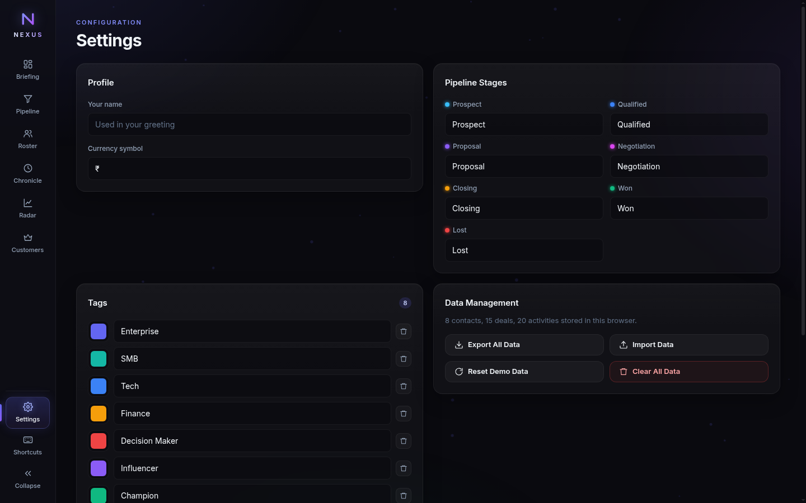
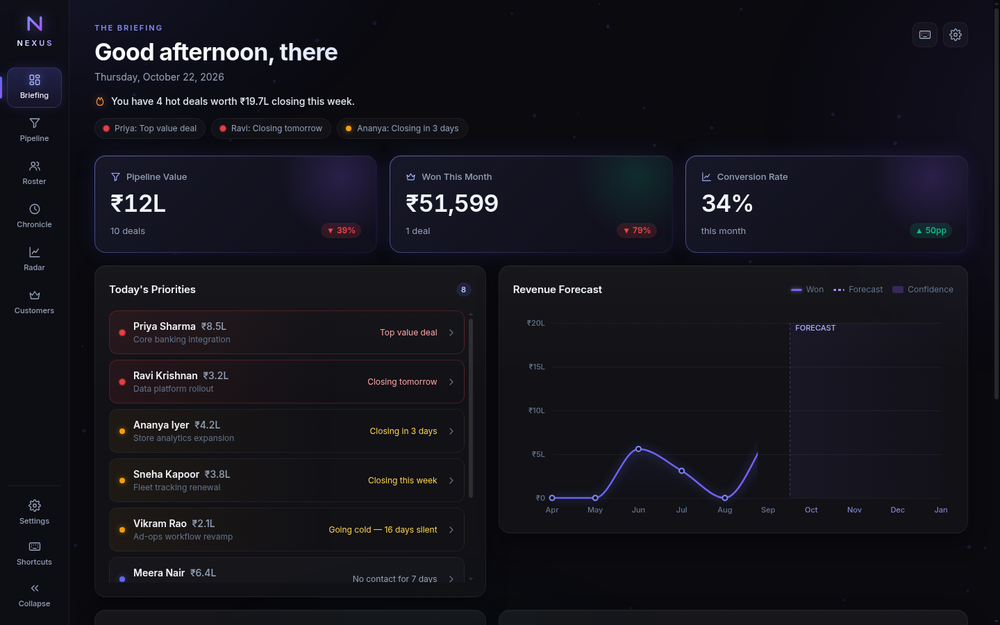
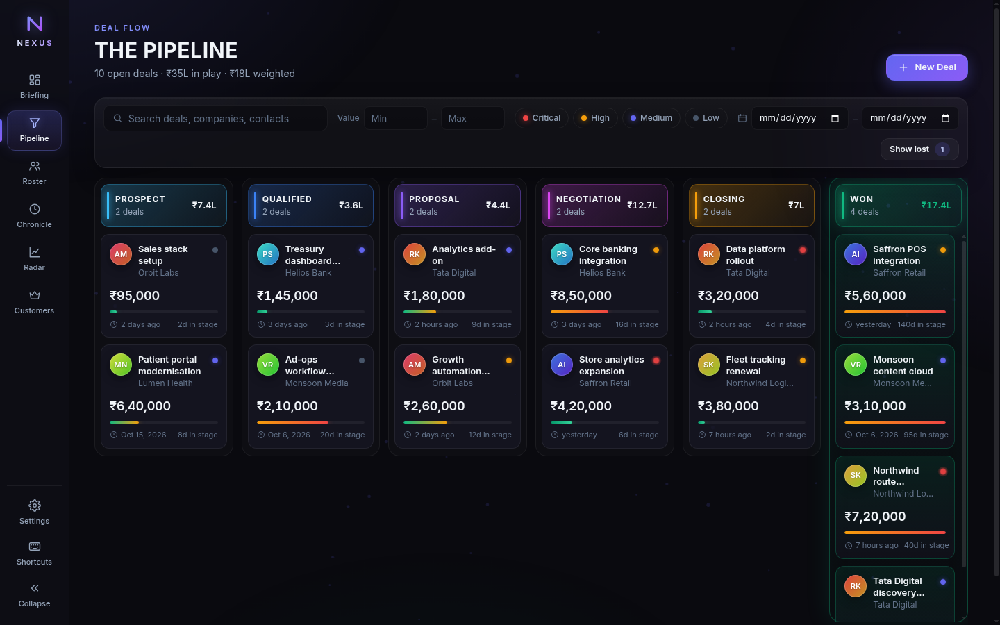
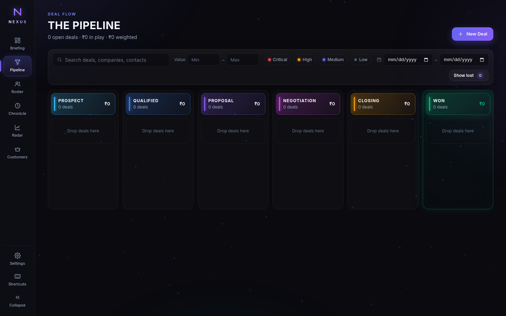
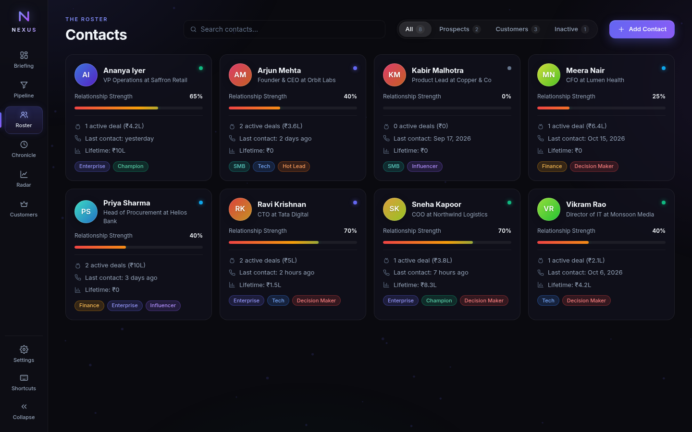
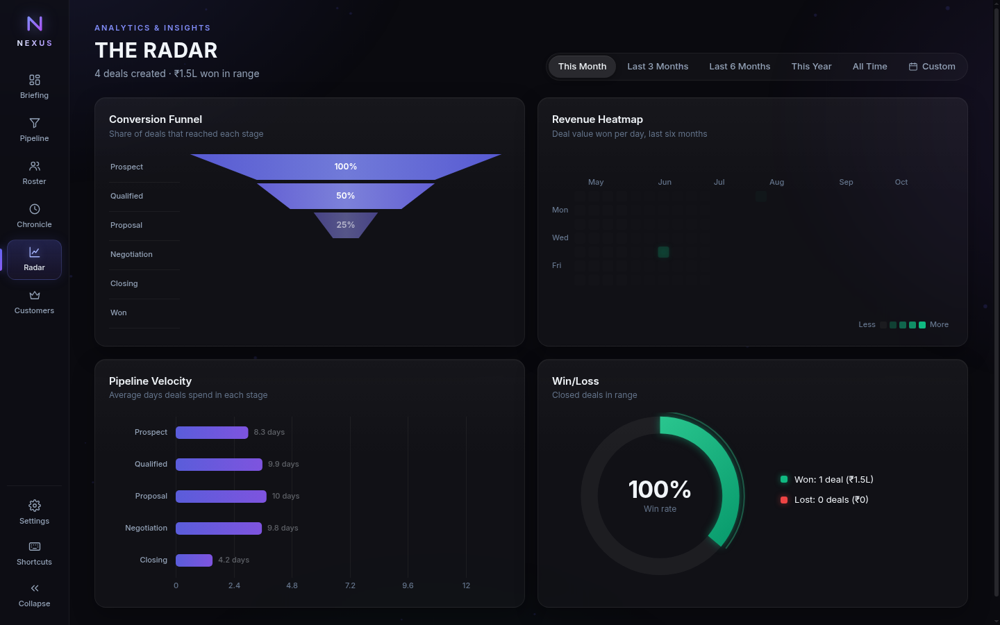
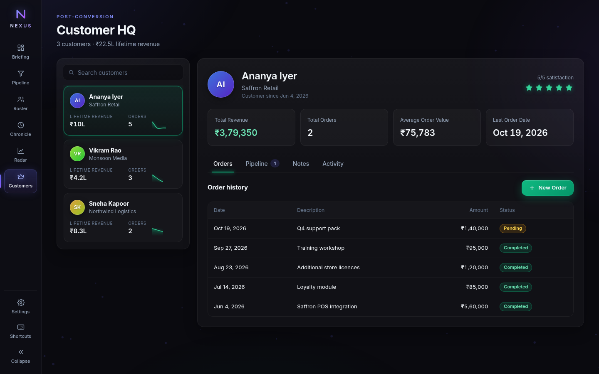

# NEXUS CRM — Enterprise Setup & User Operations Guide

> *"From Morning Briefing to Deal Close: The Complete Operating Manual for High-Velocity Sales Teams."*

---

## 🧭 Executive Introduction

Welcome to **NEXUS**. NEXUS is a dark-mode, high-density sales cockpit engineered for founders, sales directors, and account executives who demand speed, immediate clarity, and tactical focus. 

Unlike conventional CRMs bloated with deep menus and slow server round-trips, NEXUS operates as an instant-load command center built directly on modern web standards.

This guide provides everything needed to:
1. **Choose the correct instance** (interactive demo vs. clean company production).
2. **Configure company settings**, currencies, pipeline stages, and tags.
3. **Execute the daily sales workflow** across all 6 core cockpit views.
4. **Master keyboard shortcuts** and power-user interaction patterns.
5. **Establish robust data backup, security, and migration routines**.

---

## 🌐 1. Instance Selection: Demo vs. Production

NEXUS is deployed in two distinct environments to ensure client presentations and real business operations never interfere with each other:

| Environment | Live URL | Primary Purpose | Database State | Storage Key |
|---|---|---|---|---|
| **Demo Cockpit** | **[https://crm.snilld.in](https://crm.snilld.in)** | Product walkthroughs, rep onboarding, sandbox testing | Pre-seeded with realistic enterprise deals, contacts, activities, and orders | `nexus_data` |
| **Business Production** | **[https://scrm.snilld.in](https://scrm.snilld.in)** | Real company sales pipeline, confidential customer records | Starts 100% empty; clean slate for your enterprise | `nexus_scrm_data` |

```
                              ┌─────────────────────────────┐
                              │    NEXUS CRM ARCHITECTURE   │
                              └──────────────┬──────────────┘
                                             │
                     ┌───────────────────────┴───────────────────────┐
                     ▼                                               ▼
         DEMO: crm.snilld.in                            BUSINESS: scrm.snilld.in
    ┌───────────────────────────┐                   ┌───────────────────────────┐
    │ • Auto-seeded demo data   │                   │ • 100% Empty initial state│
    │ • Ideal for sales demos   │                   │ • Dedicated business data │
    │ • Reset Demo Data enabled │                   │ • Storage: nexus_scrm_data│
    │ • Storage: nexus_data     │                   │ • Reset Demo Data hidden  │
    └───────────────────────────┘                   └───────────────────────────┘
```

> [!NOTE]
> **Browser Storage Isolation:** Modern web security enforces the Same-Origin Policy. Records entered on `scrm.snilld.in` are physically isolated from `crm.snilld.in`. Data never leaks between subdomains.

---

## ⚙️ 2. Company Onboarding & Initial Setup

Before your sales team logs their first call or moves a deal, spend 5 minutes configuring NEXUS in **Settings** (`#settings` or press `6`):



### Step 2.1: Personal & Organization Profile
1. Navigate to **Settings** in the left sidebar.
2. Under **Profile & Organization**, enter your **User Name** or Company Name (e.g., `Acme Sales Lead`).
3. This dynamically personalizes your greeting on **The Briefing** dashboard.

### Step 2.2: Currency Configuration
NEXUS formats deal values, weighted pipelines, and lifetime revenues with clean international formatting:
- Select your operational currency from the dropdown:
  - **₹ (INR)** — Indian Rupee (supports Lakhs `L` and Crores `Cr` shorthand)
  - **$ (USD)** — US Dollar (supports `K` and `M` shorthand)
  - **€ (EUR)** — Euro
  - **£ (GBP)** — British Pound
  - **¥ (JPY / CNY)** — Yen / Yuan
- All existing deals and metrics automatically recalculate display formatting in real-time.

### Step 2.3: Customizing Sales Pipeline Stages
Every business has a distinctive sales motion. NEXUS comes out of the box with 7 standard stages, each carrying an automated probability weighting:

| Stage ID | Default Stage Name | Win Probability | Strategic Purpose |
|---|---|---|---|
| `prospect` | **Prospect** | 10% | Inbound lead or outbound target identified |
| `qualified` | **Qualified** | 25% | BANT qualification confirmed (Budget, Authority, Need, Timeline) |
| `proposal` | **Proposal** | 50% | Formal quotation, scope of work, or pricing sent |
| `negotiation` | **Negotiation** | 75% | Contract terms, legal review, and final discount discussions |
| `closing` | **Closing** | 90% | Verbal commitment secured; awaiting signature |
| `won` | **Won** | 100% | Contract signed; deal converted to active customer |
| `lost` | **Lost** | 0% | Opportunity closed without sale (captures structured reason) |

*To rename any stage to match your internal terminology, simply edit the label field in the Pipeline Stages panel and click Save.*

### Step 2.4: Setting Up Custom Tags & Segmentation
Tags categorize both contacts and deals across industries, sizes, and priorities:
- Enter a tag name (e.g., `Enterprise`, `SMB`, `Hot Lead`, `Renewal`, `Q4 Target`).
- Pick an accent color from the color swatches.
- Click **Add tag**.

---

## 🚀 3. Daily Sales Playbook: View-by-View Walkthrough

---

### View 1: The Briefing (`#briefing` / Hotkey: `1`)

Your day begins at **The Briefing**. Inspired by morning military and financial market briefings, this dashboard aggregates everything needing your attention before your morning coffee cools.



#### Core Widgets & UX Elements:
1. **Time-Aware Greeting & Date:** Highlights your active sales volume closing during the current week.
2. **Top-Level KPI Cards:**
   - **Pipeline Value:** Total active opportunity value + deal count and period delta.
   - **Won This Month:** Closed revenue this month + target velocity.
   - **Conversion Rate:** Win-rate efficiency percentage.
3. **Today's Priorities Engine:**
   - Evaluates all active deals and surfaces the top 5 urgent items:
     - 🔴 **Critical:** Deals closing within 7 days.
     - 🟡 **Attention:** Contacts with no touchpoints in 5+ days.
     - ⚡ **High Value:** Top 20% highest revenue opportunities.
     - ⚠️ **At Risk:** Deals stalled in the same stage for 14+ days.
4. **Revenue Forecast Chart:** High-definition Canvas area visualization plotting projected revenue alongside weighted confidence intervals.
5. **Live Activity Stream:** Chronological ticker of the latest emails, calls, and status updates across the company.

---

### View 2: The Pipeline (`#pipeline` / Hotkey: `2`)

**The Pipeline** is your tactical Kanban board for driving opportunities across the finish line.



#### How to Manage Opportunities:
- **Creating a Deal:** Click the primary `+ Deal` button in the top bar. Enter the deal title, customer/prospect name, deal value, stage, priority (`low`, `medium`, `high`, `urgent`), and closing target.
- **Progressing Deals Forward:** Click the forward arrow (`➔`) on any card to advance the deal to the next stage.
- **Accidental Move Safeguards:** Moving a deal backwards prompts a confirmation dialogue to prevent accidental status changes.
- **Marking Deals as Won:** Moving a deal to `Won` triggers an animated celebratory confetti particle burst and prompts to automatically add the account to **Customer HQ**.
- **Capturing Lost Reasons:** Moving a deal to `Lost` prompts for a structured loss category (`Price`, `Competitor`, `Timeline`, `Feature Gap`, or `Ghosted`), feeding into your win/loss analytics.
- **Filtering:** Use the top filter bar to instantly filter by title, minimum/maximum value thresholds, or priority pills.

#### Clean Business Instance (First Run):
On `scrm.snilld.in`, your pipeline starts clean and ready for your first entry:



---

### View 3: The Roster (`#roster` / Hotkey: `3`)

**The Roster** is your relationship intelligence directory.



#### Key Capabilities:
- **Relationship Health Meter (0–100%):** NEXUS calculates a composite health score for each contact based on:
  - Recency of last logged activity.
  - Number of interactions in the last 30 days.
  - Value of associated deals won.
- **Status Filtering:** Quickly toggle between `All`, `Prospects`, `Customers`, and `Inactive`.
- **Contact Card Actions:** Click any contact card to open their contact dossier, review associated deals, view their activity history, or log a call directly.

---

### View 4: The Chronicle (`#chronicle` / Hotkey: `4`)

**The Chronicle** provides a chronological record of every touchpoint between your company and your prospects.


#### Logging Interactions in Seconds:
At the top of The Chronicle sits the **Quick-Log Action Bar**:
- 📞 **Log Call:** Records call outcome (`Connected`, `Voicemail`, `No Answer`), duration, and key notes.
- ✉️ **Log Email:** Records email subject, summary, and response status.
- 🤝 **Log Meeting:** Captures agenda, attendees, and agreed next steps.
- 📝 **Add Note:** Fast internal briefing notes and deal observations.

#### Interactive Timeline:
- Visual color-coded left borders identify interaction types at a glance:
  - 🔵 Blue = Phone Calls
  - 🟢 Green = Emails
  - 🟣 Purple = Meetings
  - ⚪ Slate = Notes & System Status Changes
- Click any contact badge or deal tag inside a timeline card to immediately jump to that entity.

---

### View 5: The Radar (`#radar` / Hotkey: `5`)

**The Radar** is your executive sales analytics cockpit. Powered by native Canvas 2D rendering, it provides instantaneous visual intelligence without external analytics cookies or third-party trackers.



#### Four Diagnostic Quadrants:
1. **Sales Conversion Funnel (Top-Left):** Visualizes drop-off rates across stages to pinpoint bottlenecks in your sales cycle.
2. **Revenue Heatmap (Top-Right):** A GitHub-style daily calendar activity matrix showing revenue velocity and active dates.
3. **Stage Velocity Breakdown (Bottom-Left):** Measures the average number of days deals spend in each pipeline stage.
4. **Win / Loss Ratio (Bottom-Right):** Visual donut chart displaying the win percentage alongside loss reason categorization.

*Use the top-right date range selector to toggle between `This Month`, `This Quarter`, `Year to Date`, or `All Time`.*

---

### View 6: Customer HQ (`#customers` / Hotkey: `6`)

Once a deal is marked **Won**, the account transitions to **Customer HQ** for post-sale account management and recurring revenue tracking.



#### Account Capabilities:
- **Account Ledger:** Left panel list sorted by lifetime revenue and account activity.
- **Financial Statistics:** Real-time summary cards for Total Revenue, Total Orders, Average Order Value (AOV), and Last Purchase Date.
- **Order Management:** Click **+ New Order** to record new invoices, renewals, or expansion purchases.
- **Account Notes & Upsell Deals:** Maintain renewal opportunities directly linked to the customer account.

---

## ⌨️ 4. Keyboard Shortcuts & Power-User Controls

NEXUS is designed to be operated with minimal mouse movement. Keep your hands on the keyboard:

| Keybinding | Function | Action Taken |
|---|---|---|
| `1` | Jump to **Briefing** | Opens the morning mission dashboard |
| `2` | Jump to **Pipeline** | Opens the Kanban deal flow board |
| `3` | Jump to **Roster** | Opens the contact directory |
| `4` | Jump to **Chronicle** | Opens the activity timeline |
| `5` | Jump to **Radar** | Opens sales analytics |
| `6` | Jump to **Customer HQ** | Opens customer accounts & orders |
| `?` | **Help / Shortcuts** | Displays on-screen shortcut reference overlay |
| `Escape` | **Dismiss** | Closes any open modal, deal drawer, or popup |

---

## 🛡️ 5. Backup, Security & Data Migration Protocol

Because NEXUS operates on private client-side browser storage without transmitting customer records to external third-party database brokers, following a disciplined backup routine is recommended.

### 5.1 Performing a Weekly Backup (Export)
1. Press `6` or click **Settings**.
2. Scroll to the **Data Management** panel.
3. Click **Export All Data**.
4. NEXUS immediately generates a timestamped JSON file (e.g. `nexus-backup-2026-10-22.json`) containing every contact, deal, activity, order, tag, and pipeline setting.
5. Save this file to your company's secure Google Drive, OneDrive, or local backup repository.

### 5.2 Restoring or Migrating to a New Machine (Import)
1. Open NEXUS on the new laptop or browser.
2. Go to **Settings** ➔ **Data Management**.
3. Click **Import Data** and select your saved JSON backup file.
4. Review the preview summary (e.g. `12 contacts, 8 deals, 24 activities`).
5. Confirm the import. The complete CRM state restores immediately.

### 5.3 Resetting Demo Data vs. Clearing All Data
- **Reset Demo Data (Available on Demo instance):** Replaces all records with realistic sample data.
- **Clear All Data:** Requires two separate security confirmation prompts. Erases all records and returns the instance to a pristine empty state.

---

## ❓ 6. Frequently Asked Questions (FAQ)

#### Q: How do I invite colleagues or share data?
**A:** In the current phase, NEXUS operates as an ultra-fast, zero-cloud client cockpit. To sync state with team members, export your weekly master backup via **Settings > Export All Data** and import it on your colleague's device. Cloudflare D1/Workers synchronization is slated for Phase 2.

#### Q: Will clearing my browser cache delete my CRM data?
**A:** Clearing "Cookies and other site data" in Chrome/Firefox removes `localStorage`. Always take regular JSON backups using the **Export All Data** button in Settings before clearing browser caches.

#### Q: Can I run this offline?
**A:** Yes! Once the page is loaded, NEXUS functions without an internet connection. You can add deals, log calls, and inspect reports entirely offline while traveling.

#### Q: How do I switch the currency symbol?
**A:** Go to **Settings**, locate the **Currency** selector, and choose your preferred symbol (`₹`, `$`, `€`, `£`, `¥`). All cards and statistics update immediately.

---

## 📞 Support & Feedback
For feature requests, bug reports, or customization inquiries, submit an issue to the official repository at:
**https://github.com/appforge3b/nexus_crm**
